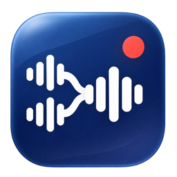
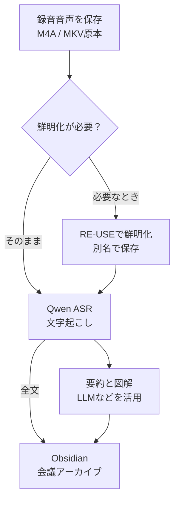
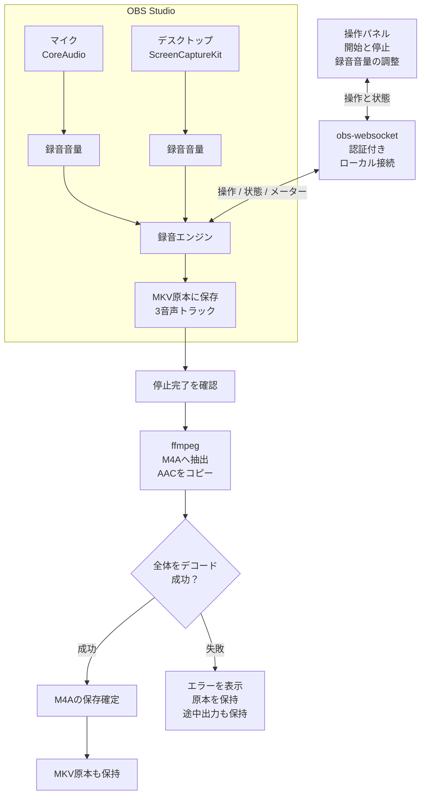

# K-YUTAA Homebrew tap

## SpacePaper

モニターと仮想デスクトップに異なる壁紙を自動で割り当てるMacアプリです。

```sh
brew install --cask K-YUTAA/tap/spacepaper
open -a SpacePaper
```

macOS 14以降、Apple Silicon／Intel共通。使い方と確認範囲は[SpacePaperのリポジトリ](https://github.com/K-YUTAA/spacepaper)を参照してください。公証していない試用ビルドです。

---

# Pairwave



**Mac audio recorder** — microphone + desktop audio

Macのマイクとデスクトップ音声を、メニューバーからM4Aで録音するアプリの配布リポジトリです。録音にはOBS Studioを使い、保存時にffmpegで音声を取り出します。

音声を残しておけば、あとから文字起こし、要約、インフォグラフィックを作り、検索できる会議のデータベースとして蓄積できます。
録音後に、必要なモデルと保存方法を選ぶ使い方を想定しています。

現在の配布版は **v1.5.0の試用ビルド**です。Developer ID署名・Appleの公証は未実施のため、macOSが初回起動を制限する場合があります。

- [インストール](#インストール)
- [作者の活用例](#作者の活用例)
- [内部構造と録音の流れ](#内部構造と録音の流れ)
- [保存と更新](#保存と更新)

## インストール

Homebrew導入済みのMacで実行してください。

```sh
brew install --cask K-YUTAA/tap/meeting-recorder
```

OBS Studioとffmpegは依存関係としてインストールされます。アプリは `/Applications/Pairwave.app` に配置されます。

- macOS 14以降
- 会議の開始・終了確認はmacOS 14.2以降
- Apple Silicon／IntelのUniversalバイナリ

OBSを手動で `/Applications/OBS.app` へ入れている場合、Homebrewが既存のアプリと衝突することがあります。その場合は、同一内容のアプリを取り込む次のコマンドでOBSをHomebrew管理へ移してから、上のコマンドを実行してください。

```sh
brew install --cask --adopt obs
```

内容が異なるため取り込めない場合は、既存OBSを上書きせず、インストール方法を確認してください。

## 初回の設定

1. OBS Studioを一度開いて初回の案内を済ませ、終了します
2. 「Pairwave」を起動します
3. メニューバーの状態表示をクリックし、「録音を開始」を選びます
4. macOSが求めるOBSのマイク・画面とシステムオーディオ収録の許可を行います

録音用のOBSプロファイルとシーンはアプリが用意します。音声の入出力先を切り替える操作は不要です。初回設定時にOBSが開いている場合は、一度終了してから開始してください。

## 主な機能

- マイクとデスクトップ音声をM4Aに保存
- 聴く音量に影響しない、録音用の音量調整
- マイク・デスクトップそれぞれの音量メーターと経過時間
- メニューバーに表示する項目の選択と、状態アイコンだけの控えめな表示
- 保存先と録音用マイクの選択
- 録音停止後にOBSを終了するかを録音設定で選択
- 会議アプリのマイク使用から、録音開始を尋ねる任意の機能
- 対象アプリのマイク使用が60秒途切れたら、停止して保存するか尋ねる任意の機能

終了確認で何も選ばない間も録音は継続します。「録音を続ける」を選んだ場合は、マイク使用が再開するまで同じ確認を繰り返しません。開始・終了確認はそれぞれ設定でオン・オフでき、初期値は両方オフです。

## 作者の活用例

会議中は音声を残し、会議が終わってから文字起こしや整理を進める使い方です。
たとえば、相手の声はAirPodsで聴き、録音用マイクはMac内蔵に固定します。
相手の声が録音では大きすぎる場合も、デスクトップ側の録音音量だけを下げれば、聴く音量を保てます。

**以下は保存した音声を別のツールで処理する活用例です。アプリが担当するのは録音と音声保存までです。**



### Qwen ASRで文字起こしする

保存した音声を、**Qwen ASR**（[Qwen3-ASR](https://github.com/QwenLM/Qwen3-ASR)など）のローカルモデルで文字に起こします。
Qwen3-ASRは日本語を含む音声認識に対応しています。
利用するモデルに対応したローカルの実行環境を別途用意し、録音後に処理します。

文字起こしの全文を残しておくと、あとから要約の切り口を変えたり、別のモデルで整理し直したりできます。
固有名詞や数字などは原音と照合し、不明瞭な箇所を残したまま扱います。

### 必要なときだけRE-USEで音声を鮮明化する

雑音や残響が気になる録音では、文字起こしの前に **[NVIDIA NemotronLabs RE-USE](https://huggingface.co/nvidia/NVIDIA-NemotronLabs-RE-USE)** で音声の鮮明化を試せます。
これは音声を入力し、処理した音声を出力するモデルです。
公式に記載された実行環境はLinuxとNVIDIA GPUで、入力はモノラルWAVです。
必要に応じてM4AをWAVへ変換し、対応する環境で処理します。

原音を保管したまま別ファイルへ出力し、聞きやすさや文字起こし結果を比較して使います。
公式のモデルカードには、発話が重なると主話者以外を抑制する性質が記載されています。
複数人の会話に一律で適用せず、必要ならMKVの音源別トラックも使って原音と比較します。

### 要約とインフォグラフィックをObsidianへ保存する

全文の文字起こしから、任意のLLMで要約を作ります。
要約には議題、決定事項、未決の課題、次の行動を整理し、会議の構造が分かるインフォグラフィックも作って**Obsidian**の会議ノートへ埋め込みます。
要約から全文と原音へ戻れるようにリンクを付けます。

保存例は次のような構成です。
ファイル名の「会議名」は実際の会議名に置き換えます。

```text
vault/
├── meetings/
│   ├── index.md
│   ├── YYYY-MM-DD-会議名.md              # 要約とインフォグラフィックへのリンク
│   └── records/
│       └── YYYY-MM-DD-会議名-全文.md     # 全文の文字起こし
└── assets/
    └── meetings/
        ├── YYYY-MM-DD-会議名-図解.png
        └── YYYY-MM-DD-会議名-raw-asr.json # 使用ツールが出力した認識結果
```

音声は録音アプリで選んだ保存先に保管し、会議ノートから参照します。
日付、会議名、テーマ、関連するプロジェクトなどをノートのプロパティや索引に付けると、検索できる会議のデータベースとして扱えます。
たとえば「この件を前に話した会議」「そのときに決めたこと」「まだ決まっていないこと」を、過去の記録からたどれます。

## 内部構造と録音の流れ

PairwaveはSwiftとAppKitで作ったメニューバーアプリです。
OBSを必要に応じて起動し、認証付きの**obs-websocket**を通して録音を制御します。
マイク音声はCoreAudioの入力ソース、デスクトップ音声はScreenCaptureKitの音声ソースで取得します。
macOSの標準入出力先を切り替える処理は行いません。



各部分の役割は次のとおりです。

| 部分 | 役割 |
| --- | --- |
| 会議録音アプリ | 開始と停止の操作、設定、録音時間と2本のメーターの表示 |
| OBS Studio | マイクとデスクトップ音声の取得、録音側の音量調整、MKVへの保存 |
| obs-websocket | アプリとOBSの間で操作や状態を伝達。音声ファイル自体は送らない |
| ffmpeg | ミックス音声のM4Aへの抽出と、ファイル全体のデコード確認 |
| 任意の会議確認機能 | CoreAudioのマイク使用情報から会議の開始や終了を推測し、操作を確認 |

MKV原本には、次の3トラックを保存します。

| トラック | 内容 | 用途 |
| --- | --- | --- |
| 1 | マイクとデスクトップのミックス | 通常再生とM4Aへの抽出 |
| 2 | デスクトップのみ | 相手側の音声の確認や後処理 |
| 3 | マイクのみ | 自分側の音声の確認や後処理 |

OBSの保存形式に合わせて、MKVには128×72の黒い映像を含めます。
画面映像やカメラ映像は記録しません。
通常使うM4Aには音声だけが入ります。

録音開始時は、OBSの録音状態に加え、経過時間と書き込み量が増えたことを確認します。
録音停止時は、OBSの停止完了を待ってからM4Aを作り、全体をデコードして問題がないことを確認した後に最終ファイル名へ変更します。
アプリが自動起動したOBSは、停止後に音源を解放して待機させます。
録音設定で指定されていれば、そのOBSを終了します。
アプリ自体の終了時も、別の録画や配信などが動作していないことを確認して、自動起動したOBSを閉じます。

OBSのWebSocketは、バックグラウンドで待機させる間も認証付きで待ち受けます。
OBS自身のIPv4待受はループバック専用ではありません。
本アプリが起動のために有効化した設定は接続後にファイル上で無効へ戻し、後でOBSを手動起動したときに有効化が残らないようにします。
待機中の待受も終了したい場合は「録音停止後にOBSを終了」をオンにします。

## v1.5.0の変更

- アプリ名を **Pairwave** に変更し、アイコンを作り直し
- 新規インストールの標準保存先は `~/Music/Pairwave`。選択済みの保存先や、以前の標準フォルダがあれば引き継ぐ
- アプリの設定とOBSの連携情報を引き継ぎ、Homebrewの登録名 `meeting-recorder` は更新の互換性のため継続
- v1.4.1の画面遷移対策と診断機能を含む。報告環境macOS 26.6 / M5でのクラッシュ解消は未確認

## v1.4.1の変更

- 専用のアプリアイコンを追加
- 録音設定と表示設定の高さをそろえ、切り替え時のガラス背景のサイズ変更を削減
- 設定表示中は、隠れている録音パネルのレイアウトを強制しないよう変更
- 録音設定に「診断情報をコピー」を追加。アプリの版・OS・表示設定・直前の画面遷移のみで、音声・保存先・OBS認証情報は含まない

macOS 26.6の別環境で「録音設定→表示設定」の停止・終了が報告されています。
作者のmacOS 27.2環境では元のクラッシュは再現できておらず、本版は遷移処理の負荷軽減と診断の追加です。
3種類の背景と2種類の表示モードで計960回の遷移と状態取得を確認しましたが、報告環境での解消は未確認です。
再発した場合はアプリを再起動し、「録音設定→診断情報をコピー」とmacOSのクラッシュレポートが切り分けに役立ちます。

## v1.4.0の変更

- 録音の開始処理や停止処理の途中でも、状態取得とパネル表示ができるように修正
- 開始確認を未回答のままにしても、録音状態の確認や操作要求の受け付けを継続
- 保存先の選択を非同期のシートに変更し、スライダー操作中もタイマーを継続
- シンボリックリンク経由の保存先を正規化し、M4A保存を開始できない場合は明示的なエラーを表示
- 会議以外の、Bundle IDを持たない音声プロセスがいても会議検出を継続
- メニューバーの文字とアイコンを背景に合わせ、録音操作の色を開始と停止で変更
- エラーの短い説明、詳細のコピー、表示の解除を追加
- 待機時の更新頻度を下げ、状態ファイルは内容の変化時に保存。操作要求はフォルダの変更通知で受け付け
- ミュートや保存対象外の音源は、ピークとRMSの両方を消すよう修正
- 「アプリを終了」を録音設定へ移動。新規環境の背景は標準のガラスを使用し、既存の選択は保持

アプリの利用に必要な外部アプリはOBS Studioとffmpegです。
メニューバーから開始と停止を操作します。

## 保存と更新

新規インストールの標準保存先は `~/Music/Pairwave` です。パネルの歯車→「録音設定」で変更できます。M4Aに加え、復旧・音源別の確認用に保存先の `OBS原本` フォルダへMKVを残します。文字起こしは行いません。

```sh
brew update
brew upgrade --cask K-YUTAA/tap/meeting-recorder
```

アンインストール：

```sh
brew uninstall --cask K-YUTAA/tap/meeting-recorder
```

録音データやOBSの設定を削除する処理は付けていません。

## 試用版の確認範囲

Apple Silicon Mac 1台で、双方の音声取得、M4A全体のデコード確認、入出力デバイスの維持、保存先の変更・保持、終了確認の未回答中の録音継続・続行選択・停止保存を確認しています。60秒の境界、マイク再開、取得エラー、スリープ相当の観測間隔は判定ロジックのテストで確認しています。

会議確認はマイク使用からの推測です。会議以外にも反応し、ブラウザーの別タブなどでマイクを使い続けていると終了を見逃す場合があります。対象を一度も検出できない場合は手動で停止してください。

Intel実機、長時間会議、別ユーザーアカウントでの初回権限操作、各会議アプリの実会議による検出精度は未検証です。

配布ZIPとSHA-256は [Releases](https://github.com/K-YUTAA/homebrew-tap/releases) に置いています。
